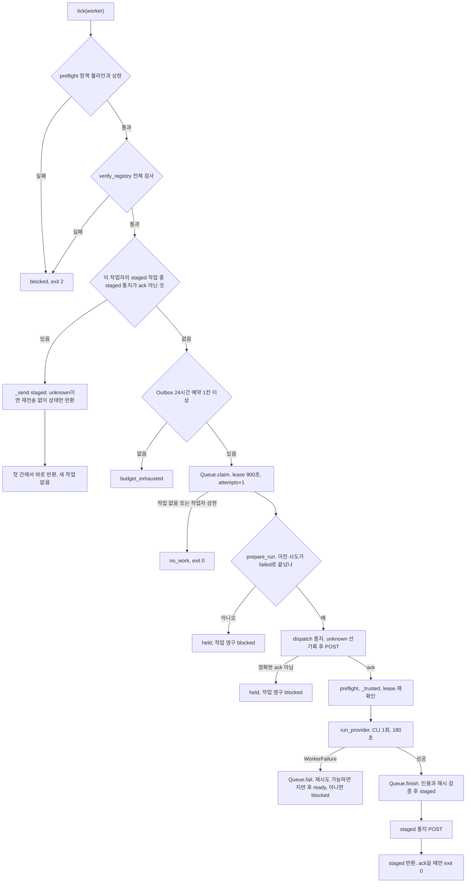

# Make 업무자동화 소스 스냅샷 검토

| 항목 | 내용 |
|---|---|
| 검토일 | 2026-11-08 (KST) |
| 대상 ZIP | `Make-automation-source-review-20261108.zip`, 192,155 bytes |
| ZIP SHA-256 | `5ee9b401462e2e0d6089ca53b885aed827e2553730ed8f24c4b3ebaf573edc73` (`SHA256SUMS.txt`와 일치, 측정) |
| 대상 브리핑 | `자동화방법_브리핑.md` (스카이넷 작성, 오세경 수신). ZIP 안의 사본과 바이트 단위로 같다 (측정). |
| 경로 표기 | 이하 파일 경로는 ZIP 압축 해제 루트 기준이다. `make_bridge.py`처럼 폴더 없이 적은 파일은 `parallel/make-collaboration/` 또는 `parallel/continuous/` 아래에 있다. |
| 검토 방법 | pstack poteto-mode의 Investigation 절차를 따랐다. how 스킬에 따라 탐색 에이전트 3개가 병렬로 읽었다. 보고서 1은 브리지 계약과 테스트, 보고서 2는 큐와 provider, 보고서 3은 보안 probe와 보조 도구를 맡았다. 해설 에이전트가 세 보고서를 종합했고, 검토자가 높음과 중간 항목의 인용을 원문에서 다시 확인했다. |
| 읽은 범위 | 핵심 모듈 `make_bridge.py`, `queue_core.py`, `provider_adapters.py`, `coordinator.py`는 전문을 읽었다. `README.md`, `MAKE-SERVER-READINESS-RUNBOOK.ko.md`, `INTEGRATION-PROTOCOL.md`, `policy.example.json`, `SOURCE-REVIEW-README.ko.md`, 브리핑도 전문을 읽었다. 보안 probe 4종, 파생 probe, launcher, harness, `test_make_bridge.py`(32개 테스트)는 탐색 에이전트가 전문을 읽었고 인용 지점은 다시 열어 확인했다. `canonical_trial_publication.py`, `partial_coverage_snapshot.py`의 쓰기 로직과 `test_snapshot_*`, `test_canonical_trial_publication.py`, `test_partial_coverage_snapshot.py`는 깊이 읽지 않았다. |
| 실행 여부 | 패키지 코드는 한 줄도 실행하지 않았다. 패키지는 신뢰할 수 없는 입력이고, 실제 Make POST와 모델 CLI 호출과 `D:` 운영 트리 쓰기 경로를 포함한다. 네트워크를 끊은 namespace 안에서의 테스트 실행 시도도 세션 권한 분류기가 거부했다. 테스트는 `D:/Hermes/cache/scratch`와 `pythoncom`에 묶여 있어 원래 호스트 밖에서는 돌지 않는다. 수행한 것은 검토자 자체 스크립트의 ZIP 해시, CRC, MANIFEST 대조, AST 파싱(측정)과, 이 검토에서 한 launcher 고정 해시 7개의 `sha256sum` 대조(측정), 이 컨테이너의 Claude Code 2.1.319 `--help` 확인(측정, 원 호스트 버전 아님)뿐이다. |

## 개요

이 패키지는 로컬 SQLite 작업 큐, Make 웹훅으로 보내는 메타데이터 통지, Claude 또는 Grok CLI를 한 번 실행하는 작업자 어댑터를 잇는 브리지의 소스 스냅샷이다. 공개 HWP 자료를 텍스트 chunk로 고정하고, chunk 하나를 작업 하나로 큐에 넣고, `make_bridge.py --tick` 한 번이 작업 하나를 꺼내 Make에 "시작" 통지를 보내고, 정확한 JSON 영수증이 오면 AI CLI를 실행해 초안을 `drafts/`에 저장한 뒤 "초안 준비" 통지를 보낸다. 정본 반영은 GPT 통합자의 수작업이고, 코드는 큐 상태를 `integrated`로 바꾸는 확인 절차만 제공한다. 무결성은 확인됐다. ZIP 해시, CRC, MANIFEST 40개 항목, 34개 `.py`의 AST 파싱이 모두 맞는다(측정).

브리핑은 대체로 정직하다. 7개 필드만 보낸다는 점, 기본값이 꺼져 있다는 점, 불확실한 Make 전송을 재전송하지 않는다는 점, 해시와 출처를 검증한다는 점은 코드와 일치한다(코드 확인). 과장된 부분은 "검증"의 강도다. 작업자 이용권과 인증 게이트는 운영자가 직접 적는 불리언이고, 인용 검증은 부분 문자열 검사라서 형식적이며, grok 작업자는 패키지 자체 테스트가 설치된 Hermes에서 거부된다고 기록한 플래그를 그대로 쓴다. **지금 상태로는 실행할 준비가 되지 않았다.** 현재 코드는 AI 작업을 Make의 정확한 ACK에 묶어 두었는데 그 ACK는 현재 수신기 그래프에서 검증되지 않았고(README.md:9), ACK가 오지 않으면 작업이 지원되는 복구 수단 없이 영구 차단된다(make_bridge.py:293-296, README.md:113). 이는 브리핑 5절 B가 피하자고 권한 바로 그 결합이며, 브리핑도 아직 바꾸지 않았다고 적는다. 정책을 true로 바꾸기 전에 5절의 "실제 업무 1건 완결"과 "ACK 분리"를 먼저 하는 것이 맞다.

## 브리핑 주장 대조

| # | 브리핑 주장 (절, 행) | 판정 | 코드 근거 |
|---|---|---|---|
| 1 | 1절(8행). 로컬 큐와 AI 초안 처리 사이에 Make 메타데이터 수신을 잇는 브리지이며, 시나리오 스위치만으로 업무가 시작되지 않는다. | 일치 | 실행 경로는 `Bridge.tick` 하나다(make_bridge.py:270-327). scheduler를 설치하지 않는다(README.md:146). 패키지 전체에 메일 발송 코드가 없다(grep). |
| 2 | 1절(10행). 새 전송, 시나리오 활성화, 유료 API 연결을 하지 않았다. | 검증 불가 | 에이전트의 행동 기록이며 패키지 밖의 사실이다. |
| 3 | 2절 1)(14행). 승인된 공개자료를 출처, 버전, 내용 해시로 확인한다. | 일치 | coordinator.py:114-173이 registry 행마다 공개 라벨, 원본과 텍스트 해시, 줄 수, ledger 결합을 검사한다. make_bridge.py:246-262가 전송 직전마다 다시 검사한다. 승인 원본 3개의 해시가 고정돼 있다(prepare_public_sources.py:121-125). |
| 4 | 2절 1)(14행). 병원 내부자료와 개인정보를 공개자료와 같은 경로로 보내지 않는다. | 부분 일치 | 경로 허용목록(queue_core.py:81-82, 129-131)과 ledger의 `public_ui_ALL` 라벨(coordinator.py:117-118, 151-153)이 막는다. 내용 수준의 개인정보 검사는 없고, 라벨은 로컬 수집 결과다(INTEGRATION-PROTOCOL.md:29). |
| 5 | 2절 2)(15행). 중복 없는 작은 작업으로 나누고 작업자, 시도 횟수, 상태를 로컬에 기록한다. | 일치 | chunk는 9000자 이하다(prepare_public_sources.py:101-116). 범위 중복은 registry 전체를 막는다(coordinator.py:141-147). refill과 enqueue가 중복을 건너뛴다(coordinator.py:211, queue_core.py:97-104). 상태와 시도는 `tasks`, `attempt_log`에 남는다(queue_core.py:37-53, 352-354). 단 실패 사유는 브리지에서 상수 `provider_failure`로 바뀐다(make_bridge.py:310). |
| 6 | 2절 3)(16행). 정해진 7개 메타데이터만 보내고 원문, 경로, 모델 답변, 비밀키는 보내지 않는다. | 일치 | 본문은 정확히 7키다(make_bridge.py:21, 51, 199-205). 키는 본문이 아니라 `x-make-apikey` 헤더로 Make에 간다(make_bridge.py:49-50). 이것은 인증을 위한 설계 의도다. |
| 7 | 2절 3)(16행). 작업 시작 시와 검증된 초안 준비 시 통지한다. | 일치 | `dispatch`는 AI 실행 전(make_bridge.py:293), `staged`는 `Queue.finish` 후(make_bridge.py:323-325)에 보낸다. |
| 8 | 2절 4)(17행). 구독 포함량과 인증이 확인된 작업자만 호출하도록 설계했다. | 부분 일치 | 게이트 코드는 있다(make_bridge.py:219-236). 하지만 확인 대상은 운영자가 정책 파일에 적은 불리언이다. 이용권, OAuth 상태, 초과 과금 설정을 조회하는 코드는 없다. README.md:125도 "실시간 결제 API 검증기가 아님"이라고 적는다. |
| 9 | 2절 4)(17행). 구현된 작업자는 claude와 grok이다. | 부분 일치 | 이름과 호출 인자는 있다(make_bridge.py:20, provider_adapters.py:21, 51-61). grok 호출의 `--run-budget 120`(provider_adapters.py:61)은 패키지 자체 테스트가 설치된 Hermes 검증기에서 거부된다고 단언한다(test_grok_readiness.py:52-57). |
| 10 | 2절 5)(18행). 초안의 출처, 인용, 해시를 검증한다. | 부분 일치 | 해시, 경로, 출처 결합은 강제된다(queue_core.py:190-251). 인용은 "인용문이 해당 줄의 부분 문자열인가"만 본다(queue_core.py:177-181, provider_adapters.py:391-394). 함의와 요약은 검사하지 않는다. |
| 11 | 2절 5)(18행). GPT 통합자가 최종 반영을 판단한다. | 문서상 주장 | 판단 절차는 산문이다(INTEGRATION-PROTOCOL.md:31-39). 코드 게이트는 메모 파일에 토큰 3개가 있는지만 본다(coordinator.py:275-277). 프로토콜도 이것이 의미 품질의 증거가 아니라고 적는다(INTEGRATION-PROTOCOL.md:18). |
| 12 | 2절 5)(18행). Make는 모델 실행이나 정본 수정을 지시하지 않는다. | 일치 | 응답은 정확히 4키 영수증과 같아야만 받아들인다(make_bridge.py:208-212). 비시험 브리지 코드에 `mark_integrated` 호출이 없다(grep). |
| 13 | 2절 6)(19행). 보고 메일은 별도의 인증과 발송 경로가 필요하다. | 일치 | 패키지에 메일 코드가 없다(grep). 결과 보고 단계는 아직 구현되지 않았다. |
| 14 | 3절(26행). 로컬 브리지, 내구성 큐, 중복 방지, 전송 계약 소스가 있고 기본 실행은 비활성이다. | 일치 | 예제 정책의 게이트는 모두 false다(policy.example.json). 인자 없는 실행은 아무것도 읽지 않고 끝난다(make_bridge.py:414-417). 단 그 출력값은 정책을 읽은 결과가 아니라 고정 문자열이다. |
| 15 | 3절(27행). 수신기 6867416은 Webhook, 영속 datastore, Webhook response의 3모듈이다. | 검증 불가 | blueprint가 포함되지 않았다. README.md:7의 서술뿐이다. |
| 16 | 3절(28행). 11월 8일 서버측 시험 이벤트 저장을 확인한 기록이 있다. | 검증 불가 | 해당 기록은 첨부되지 않았다(브리핑 89행). 패키지 안 runbook이 적은 최신 항목은 2026-11-03 Replay다(MAKE-SERVER-READINESS-RUNBOOK.ko.md:5). |
| 17 | 3절(29행). 기존 수신기 화면은 Inactive였다. | 검증 불가 | 화면은 포함되지 않았다. 문서 서술과는 일치한다(runbook:5, README.md:11). |
| 18 | 3절(31-36행). 미완료 목록 (현재 그래프 ACK, 서버 거부, 동시 중복, 배포, 이용권과 과금 차단, 업무 1건 완결). | 일치 | README.md:9와 runbook:41이 같은 항목을 미검증으로 적는다. 코드에도 이용권 검증기와 결과 보고 경로가 없다. |
| 19 | 5절 B(57-58행). Make ACK를 먼저 완성하느라 자료정리를 막는 구조를 피한다. 이는 권장안이며 아직 배포되지 않았다. | 일치 | 현재 코드는 바로 그 결합 구조다. AI는 정확한 dispatch ACK 뒤에만 돈다(make_bridge.py:293-296). |
| 20 | 6절(70행). 소비자 구독이 API나 무인 자동화를 포함한다고 가정하지 않는다. | 일치 | 작업자 게이트 기본값이 false다(policy.example.json, make_bridge.py:226-229). |
| 21 | 6절(71행). 추가 유료 API, 충전, 초과 과금을 별도 승인 없이 켜지 않는다. | 부분 일치 | 코드가 과금을 켜는 경로는 없다. 그러나 이미 켜진 초과 과금을 막거나 감지하지도 못한다. `--max-budget-usd`를 쓰지 않고(provider_adapters.py:51-57), 비용 값을 보관하지 않으며(provider_adapters.py:151-160, 218), 오류 문자열을 사후 분류할 뿐이다(provider_adapters.py:137-148). |
| 22 | 6절(72행). Make 전송 수 제한과 크레딧 상한은 다르다. | 일치 | README.md:108과 runbook:51이 같은 구분을 한다. 코드의 상한은 로컬 예약 행 수다(make_bridge.py:158-161, 183-185). |
| 23 | 6절(73행). 병원 원문, 개인정보, 인증정보를 Make나 외부 AI에 임의 전송하지 않는다. | 부분 일치 | Make 방향은 7키뿐이다(make_bridge.py:199-205). AI 방향 프롬프트에는 공개 chunk와 ID, 해시만 들어간다(provider_adapters.py:435-454). 그러나 CLI는 사용자 HOME과 설정 디렉터리를 그대로 읽는다(provider_adapters.py:22-25, 47-50). |
| 24 | 6절(74행). 불확실한 전송은 자동 재시도하지 않고 기록을 대조한다. | 부분 일치 | Make 통지는 같은 원장 안에서 재전송하지 않는다(make_bridge.py:180-181, 186-193). AI 호출의 timeout, format, process 실패는 자동 재시도된다(provider_adapters.py:182, 237, 343, make_bridge.py:310-312). 기록 대조는 도구가 없는 수작업이다(README.md:113). |
| 25 | 7절(82행). MANIFEST, SHA256SUMS, AST, ZIP CRC, 경로 중복과 탈출 검사를 했다. | 일치 | 검토자가 독립적으로 같은 결과를 얻었다(측정). 단 SOURCE-REVIEW-README.ko.md:13이 말하는 `PACKAGE-VERIFICATION.json`은 전달되지 않았다(측정). |
| 26 | 7절(82행). 기능·회귀시험을 새로 실행했다고 주장하지 않는다. | 일치 | MANIFEST에 `functional_tests_rerun: false`가 있다(측정). |

## 핵심 개념

**작업(task) 행.** `queue.sqlite3`의 `tasks` 테이블 한 행이 chunk 하나다(queue_core.py:37-45). `id`는 `sha256("<source_sha>:<first>:<last>")`이다(queue_core.py:92). 브리지는 항상 `first_line=1`, `last_line=줄 수`를 요구하므로(make_bridge.py:255) 이 값은 registry의 `task_id`(coordinator.py:173)와 같다. 같은 원문을 새 큐에 넣어도 같은 ID가 나온다는 뜻이다.

**작업 상태.** `ready`, `leased`, `staged`, `integrated`, `blocked` 다섯 가지다(queue_core.py:4-5).
- `claim`이 `ready`를 `leased`로 바꾸고 `attempts`를 1 올리고 `attempt_log`에 한 줄을 쓴다(queue_core.py:347-355).
- `finish`가 초안을 검증하고 `drafts/<id>.json`에 쓴 뒤 `staged`로 바꾼다(queue_core.py:190-231).
- `fail`이 재시도 가능하면 지연을 두고 `ready`로, 아니면 `blocked`로 보낸다(queue_core.py:295-306).
- 만료된 lease는 다음 `claim`에서 `ready`나 `blocked`로 회수된다(queue_core.py:309-318).
- `mark_integrated`가 `staged`를 `integrated`로 바꾼다(queue_core.py:267-278).
- 해시가 어긋나면 어느 단계에서든 `blocked`다. `blocked`를 되돌리는 명령은 없다.

**작업자 일일 상한.** `attempt_log`에서 최근 86400초 동안의 claim 수를 세어 작업자당 최대 24회로 막는다(queue_core.py:344-346, make_bridge.py:231). 큐 DB마다 따로 센다.

**Make 이벤트.** 정확히 7키다(make_bridge.py:21). `event_id`는 `sha256(json.dumps([kind, task_id, input_sha, attempt]))`이고 작업자는 ID에 들어가지 않는다(make_bridge.py:447). `kind`는 `dispatch`(AI 실행 전)와 `staged`(초안 저장 후) 둘이다. 그래서 성공한 시도 하나는 Make 전송 두 번을 쓴다. 재시도하면 `attempt`가 바뀌어 새 이벤트가 된다.

**Outbox 이벤트 상태.** 큐 폴더의 `make-bridge.sqlite3`에 있다(make_bridge.py:111-196). `pending`, `unknown`, `ack` 순서다. 바이트가 나가기 전에 `unknown`과 예약 시각을 먼저 commit한다(make_bridge.py:186-188). 그래서 프로세스가 죽어도 "보냈는지 모름"으로 남는다. `pending`이 아닌 이벤트는 다시 보내지 않는다(make_bridge.py:180-181). 정확한 영수증이 와야만 `ack`가 된다. `unknown`도 24시간 전송 예산을 쓴다.

**Outbox 실행 일지(runs).** 작업 시도마다 `prepared`, `started`, `failed`, `staged`, `held` 중 하나를 기록한다(make_bridge.py:121-140, 303-323). 시도 n은 시도 n-1이 `failed`로 끝났을 때만 시작할 수 있다(make_bridge.py:125-135). AI 실행 도중 죽은 흔적이 있으면 재실행 대신 멈춘다.

**영수증.** `{event_id, task_id, worker, accepted: true}`와 정확히 같아야 한다(make_bridge.py:208-212). HTTP 200, `application/json`, 16384 bytes 이하, 중복 키와 NaN 거부가 함께 걸린다(make_bridge.py:24-34, 61-66). Make 기본 응답인 평문 `Accepted`는 영수증이 아니다(README.md:99).

**정책 게이트.** 전역 불리언 3개(`production_enabled`, `make_included_plan_verified`, `make_auto_purchase_disabled_verified`), 작업자별 불리언 4개, 상한 2개다(make_bridge.py:219-236). 모두 운영자가 `policy.local.json`에 직접 적는 선언이고, 예제는 모두 false다.

**승인 체인(registry와 pointer).** `public_sources/registry.json`과 `intake/kha/current_batch.json`이 가리키는 snapshot ledger다. `verify_registry`는 전체를 한 번에 검사하고 한 행이라도 틀리면 전체를 거부한다(coordinator.py:32-37, INTEGRATION-PROTOCOL.md:13). 모든 원본이 여전히 `not_read`여야 한다(coordinator.py:161-167).

**release 파일.** probe들이 실제 전송을 시작하는 신호다. 보안 입력 창이 `ready.json`을 쓰고, 상태 폴더에 맞는 `release.json`이 나타나면 전송한다(secure_webhook_probe.py:29-51, secure_auth_probe.py:115-129). `server_contract_probe`는 `--approval-file`의 선언을 검사한다(server_contract_probe.py:123-147). launcher는 `AUTHORIZATION.json`의 `human_answer == 'ㅇㅇ'`을 본다(launcher.py:47). 이 파일들은 서명이 없고, 코드 주석도 "Unsigned operator declaration"이라고 적는다(server_contract_probe.py:124).

**WorkerFailure.** 어댑터가 던지는 `(category, retryable, delay)` 예외다(provider_adapters.py:65-71). `billing`, `entitlement`, `authentication`, `tool_use`, `model_mismatch`는 재시도하지 않고, `timeout`, `format`, `process`, `output_limit`, `provider_error`, `rate_limit`은 최대 3회까지 재시도한다.

## 동작 방식

전체 흐름은 다섯 단계다. 각 단계는 사람이 명령을 실행해야 움직이고, 자동 반복기는 패키지에 없다(README.md:146).

1. **공개자료 고정.** `prepare_public_sources.stage()`가 Windows에서 승인된 HWP 3개를 해시로 확인하고 본문 문단을 뽑아 `[SectionN/Tdddd] [Rdddddd] 본문` 형식의 줄로 만든다(prepare_public_sources.py:101-125, 222). 결과는 `public_sources/texts`, `registry.json`, `integrity.json`에 덮어쓰기 없이 쓴다. `pythoncom`이 필요하므로 Windows 밖에서는 import도 되지 않는다(prepare_public_sources.py:8).
2. **큐 채우기.** 운영자가 `coordinator.py --refill`을 실행하면 `verify_registry`가 승인 체인 전체를 검사하고, `refill`이 아직 큐에 없는 chunk를 작업자별 미해결 4건까지 넣는다(coordinator.py:191-223). 미해결은 `ready`, `leased`, `staged`만 센다(coordinator.py:188). `blocked`는 세지 않으므로 막힌 작업만큼 다음 refill이 새 작업을 넣는다. 브리지는 refill하지 않는다(README.md:132).
3. **tick 한 번.** 운영자가 `make_bridge.py --tick --worker claude`를 실행한다. `production_context`가 정책을 한 번 읽고 큐 경로, DB 형식, 승인 체인을 읽기 전용으로 확인한다(make_bridge.py:337-399). `WebhookTransport.from_environment`가 URL과 키를 환경변수에서 읽는다(make_bridge.py:80-95). 그다음 `Bridge.tick`이 아래 그림의 순서로 움직인다.
4. **AI 실행.** `run_provider`가 frozen chunk를 다시 해시로 확인하고 번호 붙은 프롬프트를 만든다(provider_adapters.py:415-454). 환경변수를 허용목록으로 거르고(provider_adapters.py:22-25, 47), 공개 작업 폴더 아래 임시 폴더에서 CLI를 한 번 실행한다(provider_adapters.py:382-385). 출력은 1 MiB, 시간은 180초로 자른다(provider_adapters.py:296-360). 응답 JSON을 엄격히 파싱하고, 인용이 해당 줄에 있는지 다시 본다(provider_adapters.py:163-237, 391-395). 그 뒤 `Queue.finish`가 같은 검사를 한 번 더 하고 초안을 fsync 후 rename으로 저장한다(queue_core.py:190-231).
5. **정본 통합.** GPT 통합자가 `coordinator.py --ready`로 staged 초안을 받아 원문과 대조하고 정본 메모에 손으로 반영한다(INTEGRATION-PROTOCOL.md:31-39). 그 메모에 task ID, source ID, source SHA를 넣고 `coordinator.py --ack`를 실행하면 큐 상태가 `integrated`가 된다(coordinator.py:258-286). 이 단계에는 코드가 판단하는 부분이 없다.

`Bridge.tick`의 순서와 관문은 다음과 같다(make_bridge.py:270-327).



이 흐름이 까다로운 이유는 상태가 두 DB에 나뉘어 있기 때문이다. 큐 DB는 작업 상태를, Outbox DB는 통지 상태와 실행 일지를 가진다. 두 DB 사이에 원자적 트랜잭션은 없다. 코드는 이 틈을 보수적으로 메운다. 통지를 보내기 전에 `unknown`을 먼저 쓰고, AI 실행 전에 일지를 `started`로 쓰고, 다음 claim에서 일지가 애매하면 재실행 대신 작업을 막는다. 그래서 중복 AI 실행과 중복 통지는 거의 불가능하다(코드 확인). 대가는 반대쪽에 있다. 애매하면 언제나 멈추고, 멈춘 것을 되살리는 도구는 없다. 아래 결함 목록의 상위 항목 대부분이 이 대가에서 나온다.

각 SQLite 메서드는 새 연결을 열고 `BEGIN IMMEDIATE`를 명시적으로 건다(make_bridge.py:126-127, 177-178, queue_core.py:341-342). Python sqlite3의 기존 트랜잭션 모드에서 이 방식은 올바르게 직렬화되고, `with db:` 안의 조기 반환은 commit된다. 탐색 에이전트 두 명이 각각 이 부분에서 트랜잭션 결함을 찾지 못했고, 이 검토도 같은 결론이다(코드 확인).

## 파일 위치

| 경로 | 역할 |
|---|---|
| `parallel/make-collaboration/make_bridge.py` | 브리지 본체. 이벤트 형식, HTTP 전송, Outbox, 정책 게이트, `Bridge.tick`, CLI. |
| `parallel/make-collaboration/policy.example.json` | 모든 게이트가 false인 예제 정책. |
| `parallel/make-collaboration/README.md`, `MAKE-SERVER-READINESS-RUNBOOK.ko.md` | 계약, 운영 게이트, 과거 검증 기록 서술. 인용된 근거 JSON 대부분은 미포함. |
| `parallel/make-collaboration/demo.py`, `test_make_bridge.py` | loopback 합성 데모와 브리지 테스트 32개. `D:/Hermes/cache/scratch` 고정. |
| `parallel/continuous/queue_core.py` | SQLite 작업 큐와 초안 검증. |
| `parallel/continuous/coordinator.py` | 승인 체인 검증, refill, status, ack CLI. |
| `parallel/continuous/provider_adapters.py` | Claude, Hermes CLI 1회 실행과 응답 파싱. |
| `parallel/continuous/prepare_public_sources.py` | Windows 전용 HWP 텍스트 추출과 registry 생성. |
| `parallel/continuous/INTEGRATION-PROTOCOL.md` | GPT 통합자의 수작업 절차. |
| `parallel/make-collaboration/secure_auth_probe.py` | 무키, 오키 요청 2건으로 401/403을 확인하는 GUI probe. |
| `parallel/make-collaboration/secure_webhook_probe.py` | 실제 URL과 키로 합성 dispatch 1건을 보내는 GUI probe(보호 원본). |
| `parallel/make-collaboration/positive-smoke-plan-20261107/source-resume-1/worker/secure_webhook_probe.py` | 파생 probe. `--campaign` 경로 추가. |
| `parallel/make-collaboration/server_contract_probe.py` | 18건 합성 계약 시험 또는 실초안 메타데이터 1건 전송기. |
| `parallel/make-collaboration/readonly_token_input.py` | Make API 토큰으로 시나리오 목록을 GET 1회 하는 GUI. |
| `parallel/make-collaboration/grok_readiness.py` | 설치된 Hermes 모듈로 grok 호출 호환성을 진단. 항상 blocked. |
| `parallel/make-collaboration/parent_review_packet.py`, `canonical_trial_publication.py`, `partial_coverage_snapshot.py` | 시범 작업 1건의 검토 묶음, 정본 게시, snapshot 교체용 부모 전용 도구. 네트워크 없음. `canonical_trial_publication.py:406-409`는 `_validated_result`로 초안을 다시 검증한 뒤 `mark_integrated`를 거치지 않고 SQL로 `integrated`를 쓴다. |
| `.../native-local-verification-1/worker/launcher.py`, `harness.py` | 2026-11-07 로컬 GUI 검증용 일회성 실행기. 고정 해시 7개는 포장된 파일과 일치한다(측정). |

## 주의점

### 높음

1. **Make ACK 실패가 작업을 되돌릴 수 없게 막는다.** 근거는 make_bridge.py:293-296, 180-181, README.md:113, coordinator.py:211이다. AI는 정확한 JSON dispatch ACK 뒤에만 돌고, 그 밖의 결과는 모두 `unknown`이 되어 `queue.fail(retryable=False)`로 작업을 영구 `blocked`로 만든다(코드 확인). 평문 `Accepted`, DNS나 TLS 실패, 4xx, timeout, 프록시가 필요한 망(make_bridge.py:54가 프록시를 끈다)이 모두 여기에 해당한다. 해제나 재큐 명령은 없고, README는 DB 편집을 금지하며, refill은 이미 있는 source를 어느 상태든 건너뛰므로 그 chunk는 그 큐에서 다시 처리할 수 없다(코드 확인). 다음 tick은 다음 `ready` 작업을 꺼내 같은 일을 반복하므로, 수신기가 틀리면 refill 한 번에 넣은 작업자당 최대 4건이 연달아 소모된다(코드 확인). 탐색 보고서 1은 이를 "하루 24에서 96건"으로 적었지만, 실제 상한은 수동 refill이 넣은 backlog다(coordinator.py:188, 205-206, 213). 현재 그래프의 새 HTTP 경로 ACK는 미검증이고(README.md:9, runbook:41) 수신기는 Inactive였다(runbook:5). Inactive 시나리오가 평문 `Accepted`를 돌려주고 요청을 쌓아 두었다가 활성화 때 처리한다면, 지금 첫 tick은 거의 확실히 작업을 막고 나중에 크레딧까지 쓴다(추론, blueprint 미포함). 새 큐로 다시 시도해도 같은 원문은 같은 `event_id`를 만들어(make_bridge.py:447, queue_core.py:92) Make의 순차 중복 거부(README.md:9)에 다시 걸릴 수 있다(추론). 영향 대상은 운영자(작업 손실), Make 크레딧이다.

2. **grok 작업자는 설치된 Hermes에서 호출 단계에서 실패한다.** 근거는 provider_adapters.py:61, test_grok_readiness.py:52-57이다. 어댑터는 `--run-budget 120`을 넘기고, 패키지 자체 테스트는 설치된 Hermes 검증기가 정확히 이 플래그를 거부하며 이 플래그를 빼면 통과한다고 단언한다(패키지 자체 테스트로 확인, 이 검토에서는 실행하지 않음). 비정상 종료는 `process` 실패로 분류되어 재시도되므로(provider_adapters.py:181-182, 206-207), grok 작업 하나가 dispatch 통지 3번과 작업자 상한 3칸을 쓰고 아무 초안 없이 `blocked`로 끝난다(코드 확인). 검증기가 gateway 호출 전에 거부한다면 AI 이용량은 쓰지 않는다(추론). 나머지 Hermes 플래그(`--query-file -`, `--oneshot`, `--format stream-json`)는 진단 도구가 Namespace를 직접 만들기 때문에 검증되지 않았다(grok_readiness.py:36-39, 코드 확인). README.md:143은 grok tick 명령 예시를 claude 명령과 나란히 싣는다. 영향 대상은 Make 크레딧과 운영자다.

### 중간

3. **AI 실패의 자동 재시도와 차단기 부재.** 근거는 provider_adapters.py:148, 182, 198, 237, 341, 343과 make_bridge.py:309-314다. timeout, format, process, output_limit, provider_error, rate_limit은 작업당 최대 3회까지 자동 재시도되고, 각 재시도는 새 dispatch 통지도 함께 쓴다(코드 확인). timeout은 이미 이용량을 쓴 호출일 수 있어서, "분류되지 않은 오류는 이용량을 썼을 수 있으니 재시도하지 않는다"는 같은 파일의 원칙(make_bridge.py:316)과 맞지 않는다(코드 확인, 이용량 소모는 추론). `billing`, `authentication`, `rate_limit`은 해당 작업만 막거나 미루고, 다음 tick은 다른 작업으로 같은 CLI를 다시 부른다(코드 확인). 작업 간 중지 장치가 없다는 뜻이며, 브리핑 5절 D도 "실패 중지"를 앞으로 할 일로 적는다. 실패 범주는 `provider_failure` 상수로 저장되고(make_bridge.py:310) 출력에도 없어서 운영자는 과금 오류와 timeout을 구분할 수 없다(코드 확인). 영향 대상은 AI 이용량, Make 크레딧, 운영자다.

4. **인용 검증이 형식적이다.** 근거는 queue_core.py:177-181, provider_adapters.py:391-394, prepare_public_sources.py:106이다. 인용문은 지정 줄의 비어 있지 않은 부분 문자열이기만 하면 통과한다(코드 확인). 모든 줄이 `[SectionN/Tdddd] [Rdddddd] `로 시작하므로 `[Section0/T0001]` 같은 머리표나 글자 한 개도 통과한다(코드 확인). `implication_ko`와 `summary_ko`는 원문과 대조하지 않고, 통합 게이트는 메모 속 토큰 3개뿐이다(coordinator.py:275-277, 코드 확인). 브리핑 2절 5)의 "인용 검증"을 품질 보증으로 읽으면 안 된다. 영향 대상은 GPT 통합자가 받는 초안의 신뢰도(데이터 품질)다.

5. **불확실한 통지 하나나 registry 변화 하나가 작업자 전체를 멈춘다.** 근거는 make_bridge.py:273, 275-284, 246-258, coordinator.py:32-37, 161-167이다. 복구 루프는 ack가 아닌 staged 통지를 처음 만나면 상태와 관계없이 바로 반환한다(코드 확인). 그래서 `unknown` staged 통지가 하나 있으면 그 작업이 통합될 때까지 그 작업자의 모든 tick이 exit 2로 끝나고 새 작업을 꺼내지 않는다. 패키지 테스트가 이 동작을 단언하지만(test_make_bridge.py:1057, 패키지 자체 테스트로 확인), README는 작업자가 멈춘다고 쓰지 않는다. staged 작업의 registry 행이 바뀌거나 빠져도 `_trusted`가 claim 전에 매번 예외를 낸다(코드 확인). registry 검증은 전부 아니면 전무라서 한 행의 오류나 정본 진행으로 인한 `not_read` 해제가 두 작업자를 모두 멈춘다(코드 확인). 프로토콜은 이 마지막 경우를 알고 재승인을 요구한다(INTEGRATION-PROTOCOL.md:27, 37, 39). 영향 대상은 운영자다.

6. **게이트와 전송 승인이 모두 자기 선언이다.** 근거는 make_bridge.py:219-236, secure_webhook_probe.py:45, secure_auth_probe.py:126-129, 265, server_contract_probe.py:124, 132-147, launcher.py:47이다. 브리지는 정책 파일의 불리언만 읽고, 이용권, OAuth, 초과 과금 상태를 조회하지 않는다(코드 확인). probe들은 상태 폴더에 맞는 `release.json`이 나타나면 전송하며, 루트 webhook probe는 자기가 `ready.json`에 쓴 `release_id` 하나만 맞으면 된다(코드 확인). 인증 probe 화면은 "스카이넷의 인증 차단검사 실행 승인을 기다립니다"라고 표시한다(secure_auth_probe.py:265). 사람이 하는 일은 비밀을 입력하는 것이고, 실제 전송 시점은 상태 폴더에 쓸 수 있는 쪽(에이전트)이 정한다(코드 확인). launcher의 사람 승인도 서명 없는 파일 속 `'ㅇㅇ'`을 맨 `assert`로 검사할 뿐이며(코드 확인), 그 파일을 누가 쓰는지는 코드가 확인하지 않는다(추론). 영향 대상은 운영자의 통제권과 Make 크레딧이다.

7. **웹훅 URL이 수신기 6867416에 묶여 있지 않고 시험 이벤트가 실제 이벤트와 구별되지 않는다.** 근거는 make_bridge.py:83-87, secure_auth_probe.py:312-317, secure_webhook_probe.py:78-82, server_contract_probe.py:125다. URL 검사는 `https://hook.us2.make.com/<영숫자>`면 어떤 훅이든 통과시키고, 시나리오 번호는 선언 파일에만 있다(코드 확인). 다른 자동화의 훅을 붙여 넣으면 합성 이벤트가 그 시나리오로 가고, 인증 probe의 첫 요청은 키가 없으므로 키 인증이 없는 훅은 그대로 처리할 것이다(추론). 시험 이벤트는 `worker='claude'`, `kind='dispatch'` 등 운영 형식 그대로이고 합성 표시는 해시 안에 숨어 있어서, 수락되면 운영 datastore에 실제 통지와 구별할 수 없는 행이 남는다(코드 확인, datastore 영향은 추론). 영향 대상은 데이터 경계와 Make 크레딧이다.

8. **파생 `--campaign` 경로는 시험이 없고 제자리에서 실행되지 않는다.** 근거는 파생 secure_webhook_probe.py:11, 56, 111-209, 334-374와 runbook:49다. `CampaignCredentialGate`는 이 파일 밖 어디에서도 참조되지 않는다(grep, 코드 확인). harness는 가짜 transport로 비캠페인 기본 모드만 돌린다(harness.py:149-163, 200-204, 코드 확인). 이 파일은 `make_bridge`와 `server_contract_probe`를 import하지만 같은 폴더에 둘 다 없다(코드 확인). 또 GUI로 받은 비밀을 `server_contract_probe.Campaign`에 넘기는데, runbook은 그 실행기가 입력창을 제공하지 않으며 비밀은 승인된 보안 환경에서만 와야 한다고 적는다(runbook:49, 코드 확인). 유일한 새 실전송 코드가 가장 덜 검증된 코드다. 영향 대상은 운영자와 Make 크레딧이다.

9. **독립 재현이 불가능하다.** 근거는 test_make_bridge.py:15, demo.py:17, prepare_public_sources.py:8, 119, test_public_sources.py:7, 91이다. 테스트와 데모가 `D:/Hermes/cache/scratch`를 고정하고, 공개자료 테스트는 실제 `D:` HWP를 읽으며, 추출기는 `pythoncom`을 import한다(코드 확인). README와 runbook이 근거로 링크한 `OFFLINE-EVENT-CONTRACT-VERIFICATION.json`, `MAKE-LIVE-ACK-VERIFICATION.json`, `AUTH-HARDENING-REPORT.json`, `LOCAL-ACCEPTANCE.md`, `MAKE-SERVER-READINESS-*.json`은 패키지에 없다(README.md:10-11, 99, runbook:10, 측정). launcher가 남기는 `RESULT.json`, `RUN.log`도 없다(launcher.py:158, 측정). 그래서 "32 tests PASS", "41 tests PASS", 로컬 GUI 검증 PASS는 모두 이 패키지만으로는 확인할 수 없다. 테스트 함수는 17개 파일에 188개 있고 skip 데코레이터는 없다(측정, 실행 안 함). 영향 대상은 사용자의 독립 검증 능력이다.

10. **전송 상한은 큐별이고 크레딧과 다르다.** 근거는 make_bridge.py:158-161, 183-185, 427, runbook:5, 51, README.md:108, 150이다. 24시간 예약 수는 큐 폴더의 `make-bridge.sqlite3`마다 따로 세고, probe 상태 폴더, 계약 시험 원장, 데모 DB도 각자 센다(코드 확인). runbook이 기록한 실행 1회 3 operations, 3 credits를 적용하면 상한 96건은 하루 약 288 크레딧, 한 달 약 8,640 크레딧이며, 다른 시나리오와 공유하는 "Make Pro 10k"에 견주면 작은 여유가 아니다(추론). `available()`은 빈 칸 하나만 확인하지만 작업 하나는 전송 두 번을 쓰므로, 23/24 상태에서는 dispatch가 마지막 칸을 쓰고 AI가 돈 뒤 staged 통지는 창이 굴러갈 때까지 기다리며 그동안 작업자는 멈춘다(코드 확인). 브리핑 6절은 이 구분을 정직하게 적었다. 영향 대상은 Make 크레딧과 운영자다.

### 낮음

11. **"ack 후 정책 재확인"은 한 tick 안에서 아무것도 잡지 못한다.** 정책은 프로세스마다 한 번 읽히므로(make_bridge.py:344, 428) make_bridge.py:297의 재확인은 같은 dict를 다시 볼 뿐이고, 이를 잡는다는 테스트는 메모리 dict를 직접 바꾼다(test_make_bridge.py:714-731). README.md:110의 문구가 과장이다(코드 확인). 영향 대상은 운영자다.

12. **dry-run 출력은 고정값이다.** make_bridge.py:414-417은 정책을 읽지 않고 `production_enabled=False`를 출력하는데, README.md:20은 이를 재검증으로 제시한다(코드 확인). 영향 대상은 운영자다.

13. **테스트 수 표기가 엇갈린다.** README.md:10은 32개, README.md:20과 181은 30개라고 적고, 파일에는 `def test`가 32개 있다(코드 확인). 영향 대상은 문서 신뢰도다.

14. **AI가 돈 뒤의 오류가 사전조건 차단처럼 보인다.** staged 통지 단계에서 `_trusted`가 예외를 내면(make_bridge.py:325, 267) 출력은 `blocked`와 일반 사유뿐이고 `task_id`와 초안 경로가 빠진다(make_bridge.py:433-436). 운영자는 이용량이 이미 쓰였고 초안이 저장됐다는 사실을 알 수 없다(코드 확인). 영향 대상은 운영자와 AI 이용량 추적이다.

15. **작업자 상한 도달이 `no_work`로 보고된다.** `claim`은 상한에 닿으면 `None`을 돌려주고(queue_core.py:345-346), 브리지는 이를 `no_work`, exit 0으로 출력한다(make_bridge.py:288-289, 431). 상한 소진과 작업 없음을 구분할 수 없다(코드 확인). 영향 대상은 운영자다.

16. **예산 경합이 작업을 영구 차단한다.** 두 프로세스가 `available()`(make_bridge.py:285)과 `deliver`의 상한 검사(make_bridge.py:183-185) 사이에서 겹치면 dispatch는 `budget_exhausted`가 되고, 아무것도 보내지 않았는데도 작업이 `make_dispatch_budget_exhausted`로 막힌다(make_bridge.py:294-295, 코드 확인). 영향 대상은 운영자다.

17. **성공한 호출이 stderr 단어나 보조 모델 기록 때문에 버려질 수 있다.** 어댑터는 성공한 실행에서도 stderr에 "billing", "authentication", "403", "usage limit" 같은 단어가 있으면 실패로 만들고(provider_adapters.py:176, 137-148), `modelUsage`가 정확히 `claude-opus-5-5` 하나가 아니면 `model_mismatch`로 영구 실패시킨다(provider_adapters.py:214-216). 메커니즘은 코드 확인이고, 실제 CLI가 그런 stderr나 보조 모델 기록을 내는지는 추론이다. 영향 대상은 AI 이용량이다.

18. **provider CLI가 사용자 설정을 읽는다.** 환경 허용목록은 `HOME`, `USERPROFILE`, `APPDATA`, `CLAUDE_CONFIG_DIR`, `HERMES_HOME`을 넘긴다(provider_adapters.py:22-25, 47-50, 코드 확인). Claude 쪽은 `--safe-mode`가 CLAUDE.md, hooks, plugins, MCP를 끈다고 2.1.319 도움말에 적혀 있어 상위 폴더 CLAUDE.md 유출 우려는 이 버전에서 완화된다(측정). 그러나 같은 도움말은 "Auth ... work normally"라고 적고, 사용자 settings 파일을 무시한다고 명시한 것은 `--restricted`뿐이어서, `settings.json`의 `env`나 `apiKeyHelper`가 결제 경로를 바꾸는지는 확정되지 않는다(추론). Hermes 쪽은 진단 도구 스스로 `private_context_runtime_verified: False`를 보고한다(grok_readiness.py:126). 탐색 보고서 2는 이를 중상으로 평가했지만, `--safe-mode` 존재가 측정으로 확인됐으므로 낮음으로 내렸다. 영향 대상은 데이터 경계와 결제 경로다.

19. **프록시 망에서 AI 호출도 실패한다.** `HTTPS_PROXY`, `NO_PROXY`, `NODE_EXTRA_CA_CERTS`는 허용목록에 없다(provider_adapters.py:22-25, 코드 확인). 병원망이 프록시를 요구한다면 dispatch는 1번 항목처럼 막히고, 설령 통과해도 CLI 호출이 실패해 재시도된다(추론). 영향 대상은 운영자다.

20. **timeout 종료가 완전하지 않다.** Hermes는 별도 gateway에서 모델을 돌리고, CLI를 죽여도 gateway 작업이 취소되는지는 검증되지 않았다(grok_readiness.py:127, 코드 확인). Linux에서 부모 Python이 죽으면 새 세션의 CLI가 남고(provider_adapters.py:298), Windows에서는 프로세스 시작 후에 Job을 붙여 짧은 경합이 있다(provider_adapters.py:299, 336, 추론). 영향 대상은 AI 이용량이다.

21. **경로 차단 정규식이 정상 문장을 거부한다.** `」/「`나 ` /비고`처럼 공백이나 구두점 뒤의 `/`를 경로로 보고 거부한다(provider_adapters.py:95, 코드 확인). 그런 원문을 인용한 응답은 `format` 실패로 재시도되며 재시도마다 이용량을 쓴다(추론). 영향 대상은 AI 이용량이다.

22. **내구성 빈틈.** 입력 파일은 임시 파일과 rename 없이 쓰고(queue_core.py:105), 초안 rename 뒤에 디렉터리 fsync가 없다(queue_core.py:224). 정전 뒤에는 해시 불일치로 작업이 막히는 쪽으로 실패한다(코드 확인). 영향 대상은 운영자다.

23. **18건 계약 시험은 설명된 그래프에서 완료에 도달하기 어렵다.** 부정 사례는 HTTP 400/422, 경합 쌍은 409/422일 때만 통과로 센다(server_contract_probe.py:204-206, 코드 확인). README.md:7이 설명하는 필터와 datastore 그래프에 오류 응답 경로가 없다면 첫 부정 사례에서 `contract_failed`로 멈추고, 그때까지의 요청은 크레딧을 쓴다(추론, runbook:34가 일부 인정). 영향 대상은 Make 크레딧이다.

24. **중복 방지는 원장 단위다.** 새 `--state-dir`이나 새 `--campaign-ledger`를 주면 같은 시험을 다시 보낼 수 있고, 파생 캠페인은 매번 같은 고정 `event_id`를 보낸다(코드 확인). runbook:52가 절차로만 금지한다. 영향 대상은 Make 크레딧과 datastore다.

25. **launcher 게이트는 `assert`이고 기한이 지났다.** 승인, 기한, 해시 고정 검사가 모두 `assert`라서 `python -O`에서 사라진다(launcher.py:45-60, 코드 확인). 기한 2026-11-07T19:28 KST는 지났다(launcher.py:48). 영향 대상은 운영자다.

26. **Python 감사 hook은 sandbox가 아니다.** harness와 검토 묶음 도구는 감사 hook으로 쓰기, 소켓, 하위 프로세스를 막지만, 스스로 OS sandbox가 아니라고 밝힌다(launcher.py:41, 코드 확인). Tcl `eval`, `ctypes`, SQLite `ATTACH`나 `VACUUM INTO` 같은 우회가 가능하다(추론). `parent_review_packet.py:190-191`의 `external_calls=False`, `make_calls=0`은 측정값이 아니라 상수다(코드 확인). 영향 대상은 검증 보고의 신뢰도다.

27. **루트 webhook probe가 비밀을 잠시 환경변수에 둔다.** secure_webhook_probe.py:54-66이 URL과 키를 `os.environ`에 넣고 `from_environment`를 부른 뒤 되돌린다(코드 확인). 그 사이 생성된 하위 프로세스는 값을 상속한다(추론). 파생본은 이를 고쳤다. 영향 대상은 데이터 경계다.

28. **문서와 코드의 작은 불일치.** provider_adapters.py:440은 줄 번호가 원문 절대 번호라고 하지만 실제는 chunk 내 1..N이며 INTEGRATION-PROTOCOL.md:7이 맞다(코드 확인). INTEGRATION-PROTOCOL.md:71은 테스트가 운영 registry와 source를 바꾸지 않는다고 하지만, test_public_sources.py:91은 `stage()`를 불러 테스트 파일 옆 `public_sources/`에 파일이 없으면 만든다(prepare_public_sources.py:196, 209-215, 코드 확인). `sqlite3.Connection.deserialize`는 Python 3.11 이상이 필요하고(make_bridge.py:376), junction 거부는 3.12의 `is_junction`에 기대는데(coordinator.py:24) 지원 버전은 어디에도 적혀 있지 않다(코드 확인). 영향 대상은 운영자다.

29. **조회 전용 토큰 도구는 범위를 강제하지 못한다.** readonly_token_input.py:20-25는 조직의 시나리오를 최대 100개까지 나열하며, 토큰의 권한 범위와 사용 후 폐기는 사용자 몫이다(코드 확인). 영향 대상은 데이터 경계다.

탐색 보고서와 다르게 처리한 항목이 있다. 보고서 2의 "Claude 플래그 미확인"은 검토자가 2.1.319에서 모든 플래그의 존재를 측정했으므로 뺐다. `--max-turns`는 도움말에 없지만 파서가 받아들인다(측정). 보고서 2의 "초과 과금을 막을 수 없음"(높음)은 3번 항목(중간)에 합쳤다. 예제 정책이 꺼져 있고 구독 포함량 안에서는 비용이 이용량 소모로 나타나며, 실제 돈이 나가는지는 계정 설정에 달려 있기 때문이다(추론). 보고서 2의 "Claude tool_use 탐지가 죽은 코드일 수 있음"은 2.1.319 도움말이 `--tools ""`를 모든 도구 비활성으로 정의하므로 결함 목록에서 뺐다(도움말 확인, 실제 호출로 시험하지는 않음). 보고서 3의 "launcher 고정 해시가 포장 파일과 일치"는 이 검토에서 `sha256sum`으로 다시 확인했다(측정).

### 검증하지 못한 것

- Make 시나리오 6867416의 실제 응답. Inactive 상태에서 평문 `Accepted`를 돌려주고 요청을 쌓는지, 중복 `event_id`에 어떤 상태 코드를 주는지, 필터에서 걸린 실행이 크레딧을 쓰는지, `{{decodeURL("application%2Fjson")}}`이 런타임에 평가되는지(README.md:16). blueprint가 없어서 1번 항목의 실제 속도를 정할 수 없다.
- 패키지의 어떤 테스트도 통과 여부를 확인하지 못했다. 원 호스트에서도 Python 3.11 이상과 `D:/Hermes/cache/scratch`가 필요하다.
- 원 호스트의 Claude Code 버전. 이 검토의 플래그 확인은 2.1.319 기준이다. 원 호스트 버전에 `--safe-mode`나 `--permission-prompts`가 없다면 모든 Claude 호출이 시작 단계에서 실패하고 재시도된다(추론).
- `claude -p --output-format json`의 실제 `modelUsage` 형태와 stderr 내용(17번 항목).
- Hermes gateway가 메모리, 프로필, 대체 모델 체인을 요청에 붙이는지, `--run-budget` 거부 시 종료 코드와 stderr가 무엇인지.
- 병원망이 프록시를 요구하는지(1번, 19번 항목).
- 실제 registry의 chunk 수. 승인 원본이 3개뿐이라 refill 몇 번이면 전부 소모될 수 있지만 개수는 알 수 없다.
- `canonical_trial_publication.py`가 하드코딩한 시범 작업 1건이 실제로 게시됐는지. 결과 기록이 포함되지 않았다.
- 브리핑이 근거로 든 `CURRENT-WORK.json`, `ack-followup-20261108-01/RESULT.json`, 현재 Make 화면(브리핑 89행).

### 권장 다음 단계

1. **정책을 true로 바꾸지 않는다.** 위 1번과 2번 항목 때문에 지금 tick을 돌리면 작업이 막히고 크레딧이 쓰일 가능성이 높다(추론).
2. **브리핑 5절 A를 먼저 고정한다.** 승인 원본 1개의 chunk 1개를 입력으로 정하고, 출력 형식, 보고 대상, 성공 조건을 한 문단으로 적는다.
3. **브리핑 5절 B대로 AI 실행을 Make ACK에서 분리한다.** 코드로는 `Bridge.tick`에서 dispatch를 AI 실행의 선행 조건에서 빼고(make_bridge.py:293-296), Make 통지는 로컬 staged 이후의 부가 통지로 바꾼다. dispatch 실패가 작업을 `blocked`로 만들지 않게 하고, 운영자가 대조 결과를 기록하는 지원 명령(`unknown`을 `ack` 또는 `abandoned`로 확정)을 추가한다.
4. **grok은 제외하거나 `--run-budget`을 뺀다.** 설치된 Hermes에서 나머지 플래그까지 실제 호출로 확인하기 전에는 grok 게이트를 false로 둔다(provider_adapters.py:61).
5. **비용 차단을 코드에 넣는다.** `billing`, `authentication`, `entitlement`, `rate_limit`이 한 번이라도 나오면 그 작업자의 이후 tick을 멈추게 하고, `WorkerFailure.category`를 `last_error`와 출력에 남기고, timeout 재시도는 기본으로 끈다(make_bridge.py:309-314). 브리핑 5절 D의 "실패 중지"를 지금 앞당기는 것이다.
6. **인용 검사를 강화한다.** 줄 머리표를 뗀 본문에 대해서만 부분 일치를 보고, 최소 길이를 둔다(queue_core.py:180, provider_adapters.py:393).
7. **웹훅 URL을 고정하고 시험 이벤트에 표시를 단다.** 정책에 예상 훅 ID의 해시를 적어 대조하고, 합성 이벤트는 운영 datastore와 다른 `schema_version`이나 별도 시나리오로 보낸다(make_bridge.py:83-87).
8. **테스트를 호스트 밖에서도 돌게 한다.** `SCRATCH`를 환경변수나 `tempfile`에서 받게 바꾸고, 원 호스트에서 전체 테스트를 다시 돌려 결과 파일을 함께 넘긴다.
9. **브리핑 5절 C대로 실제 업무 1건을 끝까지 확인한다.** 수집, 분석, 검토, 보고가 끝나 결과물이 사용자에게 한 번만 전달됐는지를 본다. 결과 보고 경로는 아직 코드가 없으므로 이 단계에서 새로 정해야 한다. 그 뒤에만 5절 D의 예약과 확장을 적용한다.

## 재현 방법

이 문서의 측정값 가운데 ZIP 해시, CRC, MANIFEST 40개 대조, `.py` 34개 AST 파싱, 테스트 함수 188개, launcher 고정 해시 7개는 아래 명령 하나로 다시 만들 수 있다. 스크립트는 ZIP을 임시 폴더에 풀어 바이트와 AST만 읽는다. 패키지의 어떤 파일도 import하거나 실행하지 않는다. Python 3.9 이상이 필요하다.

```bash
python -I reviews/tools/verify_make_snapshot.py Make-automation-source-review-20261108.zip SHA256SUMS.txt
```

모든 검사가 맞으면 `all_static_checks_passed: true`를 출력하고 종료 코드 0으로 끝난다. 하나라도 틀리면 종료 코드는 1이다. 검토 중에 파일 하나를 1바이트 바꾼 ZIP과 틀린 SHA256SUMS로 실패 경로도 확인했다(측정). 기능 테스트 실행과 CLI 플래그 확인은 이 스크립트 범위가 아니다.
